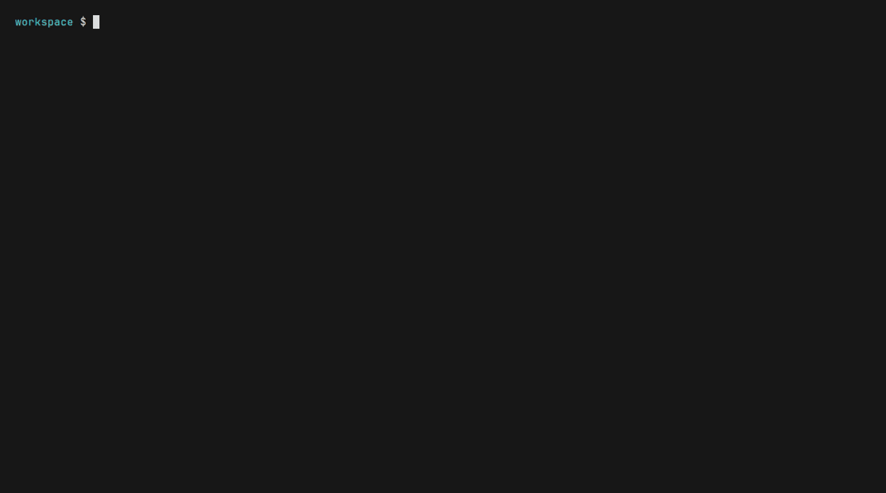

# PatchSense

`patchsense scan .` reads lockfiles, matches them to [OSV](https://osv.dev), and ranks each advisory with EPSS, CISA KEV, and CVSS. The table says which findings are **Critical**, which are **Review**, and which are **Defer**.



License: `MIT OR Apache-2.0` ([`LICENSE-MIT`](LICENSE-MIT), [`LICENSE-APACHE`](LICENSE-APACHE)).

Repository: [github.com/Widyasa/patchsense](https://github.com/Widyasa/patchsense).

## Install

Every package except `cargo install` runs a prebuilt binary. npm, Composer, Go, Homebrew, the shell installer, and Docker download it from the GitHub Release for the same version as the package (`0.1.0` downloads tag `v0.1.0`). pip installs a wheel that already contains the binary. None of those compile Rust on your machine. `cargo install` does.

Publishing is Widya's step ([`docs/release-checklist.md`](docs/release-checklist.md)). Until that release exists, Composer, Go, and Docker fail on first run and say release `v0.1.0` is not published yet. From a git checkout:

```bash
cargo build --release -p patchsense
PATCHSENSE_BINARY=$PWD/target/release/patchsense go run ./go/cmd/patchsense --version
```

That prints `patchsense 0.1.0`. `cargo run -p patchsense -- --version` does the same without a launcher.

Release archives from cargo-dist cover:

| Triple | Where it runs |
|---|---|
| `x86_64-unknown-linux-gnu` | Linux x64, glibc |
| `x86_64-unknown-linux-musl` | Linux x64, musl (Alpine) |
| `aarch64-unknown-linux-gnu` | Linux arm64, glibc |
| `x86_64-apple-darwin` | macOS x64 |
| `aarch64-apple-darwin` | macOS arm64 |
| `x86_64-pc-windows-msvc` | Windows x64 |

There is no Linux arm64 musl archive and no Windows arm64 archive.

| Ecosystem | After the v0.1.0 release | Notes |
|---|---|---|
| npm | `npm install --save-dev patchsense` then `npx patchsense scan .` | cargo-dist package. Also `pnpm add -D patchsense && pnpm exec patchsense scan .` and `yarn add -D patchsense && yarn patchsense scan .` |
| pip | `pip install patchsense` or `pipx install patchsense` or `uv tool install patchsense` | Wheels from `pypi.yml`: Linux x64/arm64 (manylinux, glibc), macOS x64/arm64, Windows x64. Not Alpine |
| Composer | `composer require --dev widyasa/patchsense` then `vendor/bin/patchsense scan .` | Root `composer.json`. First run downloads and checks sha256 |
| Go | `go install github.com/Widyasa/patchsense/go/cmd/patchsense@v0.1.0` | Same download and sha256 check. `@latest` tracks the newest tag. Before any tag, `@latest` is a pseudo-version and still looks for release `v0.1.0` |
| Homebrew | `brew install Widyasa/tap/patchsense` | Formula is pushed to `Widyasa/homebrew-tap` by the release workflow |
| shell | `curl --proto '=https' --tlsv1.2 -fsSL https://github.com/Widyasa/patchsense/releases/download/v0.1.0/patchsense-installer.sh \| sh` | cargo-dist installer. Checks sha256 before unpacking |
| Docker | `docker build -t patchsense .` then `docker run --rm -v "$PWD:/work" -w /work patchsense scan .` | Local image only. Alpine x64, so it uses the musl archive. Not published |
| cargo | `cargo install patchsense --locked` | Compiles. Needs Rust 1.99 (`rust-version` in `Cargo.toml`) |

Composer, Go, and `scripts/fetch-release.sh` (the Docker entrypoint) cache the binary under `~/.cache/patchsense` (`PATCHSENSE_CACHE_DIR` overrides it). A later run does not need the network. `curl` and PHP's curl extension honor `https_proxy` / `http_proxy`. The Go launcher uses Go's default proxy rules, which skip loopback addresses. The cargo-dist npm installer stores the binary inside the installed package and does not check sha256. The shell installer, Homebrew formula, Composer, Go, and Docker entrypoint do.

`PATCHSENSE_TARGET` overrides target detection (`x86_64-unknown-linux-musl`, for example) when libc detection is wrong. It does not change the version.

`PATCHSENSE_BINARY` skips the download for Composer, Go, and the Docker entrypoint. Set it to a `patchsense` binary you already built. An empty value is ignored. If the GitHub Release or its archive is missing, those three say release `v0.1.0` is not published yet and list `cargo install`, building from source (`cargo build --release -p patchsense`), and `PATCHSENSE_BINARY`.

`go install github.com/Widyasa/patchsense/go/cmd/patchsense@latest` before the first git tag installs a pseudo-version such as `v0.0.0-20261028141100-abcdefabcdef`. That names a commit, not a release. The launcher still requests GitHub Release `v0.1.0`, the version recorded in the source, and explains the pseudo-version when that release is missing. After the tag exists, `@latest` and `@v0.1.0` are that release.

The pip wheel does not download a release, so it has no 404 path and does not read `PATCHSENSE_BINARY`. The npm package is generated by cargo-dist when the release is published. It is not stored in this repository, and that generated installer does not read `PATCHSENSE_BINARY` either. Until the release exists, use cargo or `PATCHSENSE_BINARY` with Composer, Go, or Docker.

## Quick start

```bash
patchsense init
patchsense scan .
```

`init` writes `patchsense.toml` and does not replace an existing file unless you pass `--force`. A TTY prints a table. A pipe prints JSON. Write every report in one pass:

```bash
patchsense scan . --no-color \
  --format json --output patchsense-report.json \
  --format sarif --output patchsense.sarif \
  --format markdown --output patchsense-report.md
```

The demo GIF scans [`examples/kev-log4shell`](examples/kev-log4shell), which pins `log4j-core` 2.14.1 (CVE-2021-44228, CISA KEV). [`examples/php2shell-demo`](examples/php2shell-demo) pins PHP 8.3.35. On 25 Oct 2026 OSV returned no advisory for that Packagist `php` package, so the GIF uses Log4Shell.

## How the score works

Each finding is 0–100. Default weights sum to 100. A weight set that does not sum to 100 is scaled and a warning is printed.

| Signal | Default weight | What it measures |
|---|---:|---|
| KEV | 35 | CVE is in the CISA Known Exploited Vulnerabilities catalog |
| EPSS | 25 | FIRST exploit probability, saturated at 0.10 in `probability` mode |
| CVSS | 20 | Highest usable CVSS base score, divided by 10 |
| Direct | 10 | The package is a direct dependency |
| Fix available | 10 | OSV lists a fixed version |

Default tiers: **Critical** at 70 and above, **Review** at 40 and above, otherwise **Defer**. `--fail-on critical` is the default, so a Critical finding exits 1. Output is English only.

## GitHub Actions

Before a release, build the binary and pass `binary-path` (see [`.github/workflows/self-test.yml`](.github/workflows/self-test.yml)):

```yaml
- uses: actions/checkout@v4
- uses: dtolnay/rust-toolchain@stable
- run: cargo build --release -p patchsense --bin patchsense
- uses: ./
  with:
    path: .
    fail-on: critical
    binary-path: target/release/patchsense
```

After `v0.1.0` is released, the composite action installs the published binary. That `uses:` line depends on the release:

```yaml
- uses: Widyasa/patchsense@v0
  with:
    path: .
    fail-on: critical
```

## GitLab CI

Copy [`templates/gitlab/patchsense.gitlab-ci.yml`](templates/gitlab/patchsense.gitlab-ci.yml) or include it. The installer URL in that template depends on a GitHub Release. Details: [`docs/gitlab.md`](docs/gitlab.md).

```yaml
include:
  - local: templates/gitlab/patchsense.gitlab-ci.yml

variables:
  PATCHSENSE_FAIL_ON: critical
```

Set a masked `GITLAB_TOKEN` (project access token, `api` scope) when the job should comment on the merge request.

## MCP and `--explain`

```bash
patchsense mcp
patchsense init --print-mcp-config
patchsense init --agent
```

`--print-mcp-config` prints snippets for Cursor (`.cursor/mcp.json`), Claude Code, and Codex. It does not write those files. `--agent` writes an instruction block between `<!-- patchsense:start -->` and `<!-- patchsense:end -->` in `AGENTS.md`, `CLAUDE.md`, and `.cursor/rules/patchsense.mdc`.

`patchsense scan . --explain` asks a local read-only agent (Codex, Claude Code, or Cursor) to explain the top findings. The text is labeled `AI explanation, may be wrong`. A missing agent, a timeout, or a bad response is a warning. It does not change the exit code. This command needs one of those CLIs on `PATH`.

MCP tools: `list_supported_lockfiles`, `scan_project`, `get_finding`, `get_fix_plan`, `explain_score`. `explain_score` is deterministic. It does not call an AI model.

## Exit codes

| Code | Meaning |
|---|---|
| 0 | Scan finished and `--fail-on` did not trip |
| 1 | A finding reached the `--fail-on` bar (`critical`, `review`, `any`, or a score) |
| 2 | The scan could not run: bad config, unreadable input, or every lockfile failed |

`--fail-on never` stays 0 when findings exist. `--min-score` only hides rows. It does not change the exit code.

## Configuration

`patchsense init` writes the example. Flags override environment variables, which override the file. Useful variables: `PATCHSENSE_CONFIG`, `PATCHSENSE_CACHE_DIR`, `PATCHSENSE_FAIL_ON`, `PATCHSENSE_AGENT`, `PATCHSENSE_OSV_URL`, `PATCHSENSE_EPSS_URL`, `PATCHSENSE_KEV_URL`.

`patchsense cache info` and `patchsense cache clear` manage the SQLite cache (`~/.cache/patchsense/cache.db` on Linux).

Supported lockfiles: `package-lock.json`, `pnpm-lock.yaml`, `yarn.lock`, `poetry.lock`, `requirements.txt`, `composer.lock`, `go.sum`, `pom.xml`, `Cargo.lock`.

## Spec

The design source is [`docs/PRD.md`](docs/PRD.md). The task list is [`docs/TASKS.md`](docs/TASKS.md). Agent rules are [`AGENTS.md`](AGENTS.md).

## Contributing

Contributions are licensed under `MIT OR Apache-2.0`, the same as the project. Fork the repository, branch from `master`, and open a pull request that says `Closes #N`. [CONTRIBUTING.md](CONTRIBUTING.md) covers the toolchain, the local checks, and how to add a lockfile parser or a report format.
